# CloudForge: A Cloud-Native Collaborative Development Workspace

[](https://opensource.org/licenses/MIT)
[](https://nodejs.org/)
[](https://react.dev/)
[](https://www.typescriptlang.org/)
[](https://vitejs.dev/)
[](https://tailwindcss.com/)
[](https://expressjs.com/)
[](https://www.mongodb.com/)
[](https://www.docker.com/)
[](https://developer.mozilla.org/en-US/docs/Web/API/WebSockets_API)
[-brightgreen.svg)]()

---

## Table of Contents

1. [Executive Summary & Vision](#1-executive-summary--vision)
2. [Problem Statement & Motivation](#2-problem-statement--motivation)
3. [Key Capabilities & Feature Matrix](#3-key-capabilities--feature-matrix)
4. [System Architecture](#4-system-architecture)
   - [Architectural Topology](#41-architectural-topology)
   - [Subsystem Decomposition](#42-subsystem-decomposition)
5. [Literature Review & Theoretical Foundation](#5-literature-review--theoretical-foundation)
   - [Reviewed Papers (RP_1 to RP_10)](#51-reviewed-papers-rp_1-to-rp_10)
   - [State-of-the-Art Research Gap Matrix](#52-state-of-the-art-research-gap-matrix)
6. [Deep-Dive Feature Specifications](#6-deep-dive-feature-specifications)
   - [6.1 Browser-Based Multi-Tab IDE & Monaco Editor](#61-browser-based-multi-tab-ide--monaco-editor)
   - [6.2 Real-Time Collaboration & CRDT Document Sync](#62-real-time-collaboration--crdt-document-sync)
   - [6.3 Container Sandboxing & Execution Isolation](#63-container-sandboxing--execution-isolation)
   - [6.4 Jailed Cloud Terminal & WebSocket PTY Gateway](#64-jailed-cloud-terminal--websocket-pty-gateway)
   - [6.5 Visual Git Engine, Diff Viewer & Commit Graph](#65-visual-git-engine-diff-viewer--commit-graph)
   - [6.6 Live Web Application Preview & Reverse Proxy](#66-live-web-application-preview--reverse-proxy)
   - [6.7 Interactive Multi-Language Execution & Jupyter Notebooks](#67-interactive-multi-language-execution--jupyter-notebooks)
   - [6.8 Starter Template Presets & Client-Side ZIP Packaging](#68-starter-template-presets--client-side-zip-packaging)
7. [Repository Layout & Directory Tree](#7-repository-layout--directory-tree)
8. [Comprehensive REST API Reference](#8-comprehensive-rest-api-reference)
9. [WebSocket Protocol Specifications](#9-websocket-protocol-specifications)
10. [Localhost Installation & Quickstart Guide](#10-localhost-installation--quickstart-guide)
    - [Prerequisites](#101-prerequisites)
    - [Backend Setup (Zero-Config DB)](#102-backend-setup-zero-config-db)
    - [Frontend Setup](#103-frontend-setup)
    - [Dual-Mode Execution Configuration](#104-dual-mode-execution-configuration)
11. [Environment Variables Reference](#11-environment-variables-reference)
12. [Automated Verification & Test Suites](#12-automated-verification--test-suites)
13. [Security Architecture & Threat Mitigation](#13-security-architecture--threat-mitigation)
14. [Future Cloud-Native Scalability Roadmap](#14-future-cloud-native-scalability-roadmap)
15. [License & Acknowledgments](#15-license--acknowledgments)

---

## 1. Executive Summary & Vision

**CloudForge** is an open-source, cloud-native, browser-based collaborative development platform designed to deliver an end-to-end software engineering environment directly within any modern web browser. It completely eliminates local machine configuration overhead, cross-platform dependency drift, and the notorious *"works on my machine"* syndrome.

By uniting an industrial-grade code editor (**Monaco Editor**), multi-user synchronous editing powered by **Conflict-Free Replicated Data Types (CRDTs)**, containerized sandboxes (**Dockerode**), a real-time WebSocket **Cloud Shell**, visual **Git source control & commit timeline graphs**, an integrated **Live Web App Preview reverse proxy**, and **dynamic starter templates**, CloudForge brings the power of full-stack desktop IDEs to an instant-boot, zero-install web interface.

---

## 2. Problem Statement & Motivation

Traditional software engineering workflows impose substantial friction on developers, educational institutions, and distributed teams:

1. **Dependency Hell & Machine Configuration Drift:** Developers spend hours configuring SDKs, runtimes (Python, Node.js, C++, Java), system paths, compilers, and database daemons. Inevitable differences across Windows, macOS, and Linux cause subtle runtime failures.
2. **Fragmented Developer Toolchains:** Developers must constantly toggle between disparate applications: a local text editor, an operating system terminal, a separate Git GUI client (or CLI commands), browser windows for web app previews, and third-party tools for pair programming.
3. **Heavyweight Commercial Cloud IDEs:** Existing commercial solutions (such as GitHub Codespaces, Gitpod, or CodeSandbox) often impose heavy cloud credit costs, proprietary devcontainer configurations, vendor lock-in, and significant boot latency (>30 seconds) on cold starts.
4. **Shallow Collaborative Editors:** Web-based collaborative tools typically focus on single-file transient buffers (like Google Docs or interview whiteboard pads) without true project directory trees, persistent document schemas, visual staging areas, branch switching, or bidirectional GitHub remote synchronization.

**CloudForge solves this by delivering a lightweight, zero-configuration, fully self-hostable cloud development workspace accessible from any browser.**

---

## 3. Key Capabilities & Feature Matrix

| Feature | CloudForge Implementation | Benefit to Developers |
| :--- | :--- | :--- |
| **Browser-Based IDE** | Monaco Editor, multi-tabs, line gutter, minimap, find/replace, custom themes | Rich, VS Code-familiar editing environment without local installs |
| **Hierarchical File Explorer** | Expandable/collapsible tree, syntax icons, multi-file upload, recursive delete/rename | Full multi-file project structure and directory management |
| **Real-Time Collaboration** | Yjs CRDTs, WebSocket gateway (`/ws/collaboration`), live cursor tracking, activity feed | Sub-millisecond synchronous pair-programming with mathematical convergence |
| **Container Sandboxing** | Dockerode container isolation with automatic local workspace sandbox fallback | Safe, reproducible code execution environments for every project |
| **Interactive Cloud Shell** | Xterm.js + WebSocket gateway (`/ws/terminal`), jailed to `/workspace`, disk-to-DB sync | Full bash/sh shell execution, CLI compilation, and package management |
| **Visual Git & Source Control** | Staged vs. unstaged tracking, status pills (A, M, D), commit timeline graph, branch switcher | Intuitive Git management without memorizing complex CLI commands |
| **Side-by-Side & Unified Diff** | Dual-mode diff viewer with colored inline character/line additions and deletions | Comprehensive pre-commit inspection and review of commit history |
| **Bidirectional GitHub Sync** | GitHub REST API v3 integration for remote linking, repo publishing, and tree pulls | Seamless interoperability with existing GitHub repositories |
| **Live Web App Preview** | Dynamic port detection, reverse proxy streaming (`/api/projects/:id/preview/:port`), split view | Real-time visual feedback for web applications directly in the IDE |
| **Interactive Execution Kernel** | Jupyter Notebook (`.ipynb`) viewer, stateful cell execution for Python and JavaScript | Data science and rapid algorithmic experimentation in-browser |
| **Dynamic Starter Templates** | React+TS, Node Express, Python, Go, Rust, C++, Java, Web, and Blank presets | Instant one-click project bootstrap and in-place stack re-seeding |
| **Zero-Config Database** | Dual-mode Mongoose: auto-boots `mongodb-memory-server` if local MongoDB is absent | Runs instantly on any developer machine without pre-installed databases |
| **Workspace Portability** | Client-side ZIP bundling via `JSZip` | Full local backup and export of project code at any time |

---

## 4. System Architecture

### 4.1 Architectural Topology

```mermaid
flowchart TD
  subgraph Client ["Client Tier (Browser - React 19 + TypeScript + Vite)"]
    UI["CloudForge Workspace Interface"]
    Monaco["Monaco Multi-Tab Editor"]
    Xterm["Xterm.js Cloud Shell"]
    CollabClient["Yjs CRDT Collaboration Client"]
    PreviewIframe["Live Web App Preview (Split / Tab)"]
    VCSUI["Source Control & Commit Graph UI"]
  end

  subgraph Gateway ["Application Gateway Tier (Node.js + Express 5.2)"]
    AuthMW["JWT & Cookie Authentication Middleware"]
    ProjectCtrl["Project & Workspace Controllers"]
    VCSCtrl["Git & Version Control Controllers"]
    PreviewProxy["Preview Reverse Proxy & Port Scanner"]
    TermWS["Terminal WebSocket Gateway (/ws/terminal)"]
    CollabWS["Collaboration WebSocket Gateway (/ws/collaboration)"]
  end

  subgraph Compute ["Compute & Execution Tier (Docker & Host Sandbox)"]
    DockerDaemon["Dockerode Dev Container (Node/Python/C++/Rust)"]
    HostSandbox["Host Sandbox Fallback (Isolated Storage Subdir)"]
    DiskWatcher["Real-Time Disk-to-DB File Watcher"]
  end

  subgraph Storage ["Persistence & State Tier"]
    MongoMemory[("MongoDB Memory Server (Zero-Config Fallback)")]
    MongoAtlas[("MongoDB Atlas / Local MongoDB (Persistent URI)")]
    LocalFS[("Workspace Storage Directory (/Backend/storage/)")]
  end

  subgraph External ["External Services"]
    GitHubAPI["GitHub REST API v3"]
  end

  UI --> Monaco
  UI --> Xterm
  UI --> VCSUI
  UI --> PreviewIframe

  Monaco <-->|CRDT Binary Updates| CollabWS
  Xterm <-->|Bidirectional PTY Stream| TermWS
  PreviewIframe <-->|HTTP Reverse Proxy| PreviewProxy
  VCSUI -->|REST API Requests| VCSCtrl
  UI -->|File CRUD & Project API| ProjectCtrl

  ProjectCtrl --> AuthMW
  VCSCtrl --> AuthMW
  PreviewProxy --> AuthMW

  ProjectCtrl --> DockerDaemon
  ProjectCtrl -.-> HostSandbox
  TermWS <--> DockerDaemon
  TermWS -.-> HostSandbox
  DiskWatcher <--> LocalFS
  DiskWatcher -.-> ProjectCtrl

  ProjectCtrl --> MongoMemory
  ProjectCtrl -.-> MongoAtlas
  VCSCtrl <--> GitHubAPI
```



### 4.2 Subsystem Decomposition

1. **Client Tier (`/Frontend`):** Built with React 19, TypeScript, and Vite. Utilizes `@monaco-editor/react` for high-performance syntax-highlighted code editing, `@xterm/xterm` for terminal rendering, `marked` and `katex` for technical documentation rendering, and `jszip` for client-side workspace packaging.
2. **Application Gateway Tier (`/Backend`):** Built on Express 5.2 with modular controllers and middleware. It hosts two dedicated WebSocket gateways (`/ws/terminal` and `/ws/collaboration`), enforces JWT-based authentication guards, and proxies HTTP traffic to dynamically running ports inside workspaces.
3. **Compute & Execution Tier:** Integrates `dockerode` to spin up isolated container runtimes with strict CPU/memory limits. When Docker is not available on the host, CloudForge seamlessly activates an isolated local workspace directory jail (`/Backend/storage/<projectId>/`).
4. **Persistence Tier:** Utilizes Mongoose 9.9 with dual-mode connectivity: connects to an existing MongoDB URI or automatically spawns an in-memory database daemon via `mongodb-memory-server`.

---

## 5. Literature Review & Theoretical Foundation

CloudForge is grounded in empirical research and peer-reviewed literature across container orchestration, cloud-based collaborative editing, and developer productivity environments.

### 5.1 Reviewed Papers (RP_1 to RP_10)

| ID | Title & Authors | Year & Venue | Core Contribution | Limitations & Research Gaps |
| :---: | :--- | :---: | :--- | :--- |
| **RP 1** | *Leveraging Container Orchestration with Docker and Kubernetes for Web-Based IDEs*<br>Y. Tayyebi et al. | 2025<br>PIEMR | Microservices web IDE using Docker containers and Kubernetes HPA for multi-tenant isolation. | Lacks visual Git staging, interactive diff inspection, and zero-install client workspace persistence. |
| **RP 2** | *Real Time Code Collaborator: A Cloud-Based Platform for Seamless Multi-User Programming*<br>S. T. Shruthi et al. | 2025<br>IJARCCE | Full-stack collaborator using WebSockets for sub-second editing and Docker sandboxes. | Designed for transient interview pair sessions; lacks persistent directory trees, commit graphs, and GitHub sync. |
| **RP 3** | *Cloud vs. Local Development Stacks: Leveraging CDE and PaaS Platforms for Academic Labs*<br>R. I. Zuhairnawan et al. | 2026<br>e-Proc. Eng. | Benchmarked CDEs (Codespaces, DevZero) and PaaS for boot time, latency, and resource footprint. | Evaluates existing commercial platforms without offering an open-source, lightweight standalone architecture. |
| **RP 4** | *Creating a Standardized Environment for Learning Management using GitHub Codespaces*<br>A. D. Snowberger & K. You | 2024<br>JPEE | Containerized devcontainer workflows in computer science labs to eliminate setup friction. | Heavy dependency on proprietary Microsoft quotas; high cloud credit costs and VM boot delays. |
| **RP 5** | *CoVSCode: A Novel Real-Time Collaborative Programming Environment for Lightweight IDE*<br>H. Fan et al. | 2019<br>MDPI Appl. Sci. | Operational Transformation (OT) extension for VS Code enabling multi-cursor tracking. | Confined strictly to desktop VS Code installations; lacks zero-install browser access and containerized runtimes. |
| **RP 6** | *The Impact of Docker, DevOps, and GitHub on Collaborative Open Source Software Development*<br>P. S. Emmanni | 2023<br>EJAET | Empirical study on how Docker, CI/CD, and GitHub version control accelerate developer velocity. | Qualitative analysis without proposing an integrated architecture or embedding visual Git workflows in a browser IDE. |
| **RP 7** | *ATCoPE: Any-Time Collaborative Programming Environment for Synchronous & Asynchronous Teamwork*<br>H. Fan et al. | 2012<br>ACM GROUP | Theoretical unification of synchronous pair programming with asynchronous branch version control. | Focuses on buffer concurrency algorithms; lacks modern web containers, GitHub API, diff UI, and cloud terminals. |
| **RP 8** | *Building Temporary Isolated Workspace in Real-Time Collaborative Programming Environment*<br>J. Jiang et al. | 2023<br>IEEE SMC | RECON model isolating broken intermediate code into sandbox buffers during joint editing. | Restricted to buffer-level syntactic isolation; does not address multi-file project persistence or cloud terminals. |
| **RP 9** | *DoCloud: An Elastic Cloud Platform for Web Applications Based on Docker*<br>C. Kan | 2016<br>IEEE ICACT | Elastic cloud hosting platform using Docker containers with predictive (ARMA) and reactive auto-scaling. | Tailored exclusively for server deployment; lacks developer IDE interface, file explorer, or source control tooling. |
| **RP 10** | *ChainIDE: A Cloud-Based Integrated Development Environment for Smart Contracts*<br>H. Qiu et al. | 2020<br>IEEE/ACM Blockchain | Multi-ecosystem cloud IDE with cloud compilation, asynchronous compiler microservices, and templates. | Domain-specific for blockchain smart contracts; lacks generic full-stack developer tooling, visual Git, and terminal access. |

### 5.2 State-of-the-Art Research Gap Matrix

```
+---------------------------------------------------------------------------------------------------------+
|                                    RESEARCH GAP TAXONOMY MATRIX                                         |
+------------------------------------+---------------------------------------+----------------------------+
| Research Dimension                 | State-of-the-Art Literature           | CloudForge Unified Solution|
+------------------------------------+---------------------------------------+----------------------------+
| 1. Version Control Integration     | CLI-only commands (RP 1, RP 6)        | Visual Git DAG & Diff UI   |
| 2. Development Setup Overhead      | Heavy VMs & Subscription Quotas (RP 4)| Zero-Install Browser IDE   |
| 3. Buffer vs. Workspace Lifecycle  | Transient In-Memory Buffers (RP 2, 8) | MongoDB Hierarchical Tree  |
| 4. Diff & Change Inspection        | Basic Raw Text Differences (RP 7)     | Split & Unified Diff Engine|
| 5. Project Starter & Re-seeding    | Static Single Repositories (RP 10)    | In-Place Template Engine   |
| 6. Remote Repository Interop       | Manual Local Clones / Pulls (RP 6)    | Bidirectional GitHub REST  |
| 7. Execution & Sandboxing          | Heavy Cloud Infrastructure (RP 3, 9)  | Dual-Mode Docker/Local Jail|
| 8. In-Workspace Web App Preview    | External Browsers / Port Forwarding   | Integrated Reverse Proxy   |
+------------------------------------+---------------------------------------+----------------------------+
```

---

## 6. Deep-Dive Feature Specifications

### 6.1 Browser-Based Multi-Tab IDE & Monaco Editor
- Powered by `@monaco-editor/react`, supporting over 50 programming languages.
- Full multi-tab bar with dirty-state indicators (unsaved circles), close actions, and active tab switching.
- Keyboard shortcuts: `Ctrl+S` (Save file), `Ctrl+F` (Find), `Ctrl+H` (Find & Replace), `Ctrl+P` (Quick file navigation).
- Rich custom viewers:
  - **Markdown Viewer:** Interactive preview with GitHub-style callouts (`[!NOTE]`, `[!TIP]`, `[!IMPORTANT]`) and copyable code blocks.
  - **LaTeX Viewer:** Mathematical formulas rendered via KaTeX with live equation formatting.
  - **IPYNB Viewer:** Interactive Jupyter Notebook layout showing cells, markdown explanations, and execution outputs.

### 6.2 Real-Time Collaboration & CRDT Document Sync
- **Protocol:** Operates over a dedicated WebSocket gateway at `ws://localhost:5000/ws/collaboration`.
- **CRDT Engine:** Integrates `Yjs` for conflict-free mathematical convergence across multiple concurrent typists.
- **State Vector Handshake:** When a user opens a file, the client transmits `document_sync_step_1` containing its local state vector. The server replies with `document_sync_step_2` containing the missing binary updates.
- **Incremental Binary Updates:** Subsequent edits transmit compact delta frames (`document_update`), slashing bandwidth consumption compared to sending full document text.
- **Debounced Storage Flush:** In-memory CRDT mutations are automatically saved to MongoDB every 8 seconds, or immediately upon user departure.
- **Presence & Remote Cursors:** Transmits cursor positions (`line`, `column`) and selections, rendering colored remote user cursors and name flags in real time.
- **Activity Feed:** Broadcasts throttled, user-friendly activity events (`"Alice edited main.py"`, `"Bob committed changes"`).

### 6.3 Container Sandboxing & Execution Isolation
- Built upon `dockerode`, providing isolated Linux container environments for each project.
- **Resource Quotas:** Standard defaults enforce `1536 MB RAM` and `1.5 CPU Cores` per workspace to prevent resource exhaustion.
- **Zero-Config Host Sandbox Fallback:** If Docker is not running or unavailable on the host system, CloudForge automatically falls back to an isolated workspace sandbox under `/Backend/storage/<projectId>/workspace/`.
- Terminal navigation within the sandbox is strictly jailed to `/workspace` using custom shell initialization flags, preventing traversal into the host's root operating system.

### 6.4 Jailed Cloud Terminal & WebSocket PTY Gateway
- Terminal emulator powered by `@xterm/xterm` with the `@xterm/addon-fit` and `@xterm/addon-web-links` plugins.
- Connects to `ws://localhost:5000/ws/terminal?projectId=<id>&token=<jwt>`.
- Supports bidirectional interactive input/output, ANSI color codes, text selection, and command execution (e.g., `npm install`, `python app.py`, `git status`).
- **Disk-to-DB Real-Time Synchronization:** A file watcher automatically detects files created, modified, or deleted inside the terminal shell and synchronizes them to MongoDB and the frontend File Explorer in real time.

### 6.5 Visual Git Engine, Diff Viewer & Commit Graph
- **Working Tree Tracking:** Distinguishes between Staged and Unstaged changes with modification badges: `A` (Added), `M` (Modified), and `D` (Deleted).
- **Staging Controls:** One-click Stage All, Unstage All, or per-file staging and change discarding.
- **Interactive Commit Diff Viewer:**
  - **Side-by-Side (Split) Mode:** Displays original and revised code in adjacent panes with aligned line numbering.
  - **Unified Mode:** Standard line-by-line diff with inline green additions and red deletions.
- **Commit History Graph:** Chronological DAG timeline displaying commit messages, author names, relative timestamps, and short SHA hashes.
- **Branch Management:** Switch between active branches (`main`, `dev`, `feature`) or create new branches on the fly.
- **GitHub Integration:** Link an existing GitHub repository URL, publish a new public/private repository, and synchronize commits bidirectionally using personal access tokens.

### 6.6 Live Web Application Preview & Reverse Proxy
- Automatically scans and detects active HTTP listening ports within the workspace container (e.g., 3000, 5000, 5173, 8080).
- Provides an integrated reverse proxy router at `/api/projects/:id/preview/:port/*`.
- Embeds a resizable split-screen iframe or separate preview tab featuring an address bar, reload button, external window launcher, and viewport mode toggles (Desktop, Tablet, Mobile).

### 6.7 Interactive Multi-Language Execution & Jupyter Notebooks
- Multi-language runtime detection automatically identifies project types (Node.js, Python, C++, Go, Rust, Java, Web).
- Interactive code execution endpoint (`/api/projects/:id/execution/run`) evaluates code snippets and streams back stdout, stderr, and execution duration.
- Stateful Jupyter kernel controller (`/api/projects/:id/kernel/execute`) manages in-memory variable scopes across consecutive notebook cell executions.

### 6.8 Starter Template Presets & Client-Side ZIP Packaging
- Pre-configured starter templates ready for instant seeding:
  1. **React + TypeScript (Vite):** Full modern single-page application setup.
  2. **Node.js + Express:** REST API starter with JSON middleware and test endpoints.
  3. **Python Application:** Modular Python script setup with environment templates.
  4. **Go Web Server:** Lightweight Go HTTP server setup.
  5. **Rust CLI / App:** Standard `Cargo.toml` and `main.rs` scaffolding.
  6. **C++ Project:** Modern C++ application with Makefile and build scripts.
  7. **Java Application:** Standard Java project structure.
  8. **Static Web:** HTML5, CSS3, and modern JavaScript starter.
  9. **Blank Project:** Clean slate for custom architectures.
- **Instant Client-Side ZIP Packaging:** Generates a structured ZIP file of the entire workspace directly inside the browser using `JSZip`, allowing instant offline download.

---

## 7. Repository Layout & Directory Tree

```text
CloudForge/
├── Backend/
│   ├── src/
│   │   ├── config/
│   │   │   └── db.js                        # Dual-mode Mongoose & MongoMemoryServer manager
│   │   ├── controllers/
│   │   │   ├── authController.js            # User registration, login, JWT issuance
│   │   │   ├── containerController.js       # Container lifecycle & metrics inspection
│   │   │   ├── deployController.js          # Deployment & export management
│   │   │   ├── executionController.js       # Code execution runner endpoints
│   │   │   ├── githubController.js          # GitHub OAuth & repository synchronization
│   │   │   ├── kernelController.js         # Interactive Jupyter notebook cell execution
│   │   │   ├── previewController.js         # Port discovery & reverse proxy streaming
│   │   │   ├── projectController.js         # Project CRUD & listing
│   │   │   └── workspaceController.js       # File tree CRUD, Git commits, Template re-seed
│   │   ├── middleware/
│   │   │   └── auth.js                      # JWT authentication verification middleware
│   │   ├── models/
│   │   │   ├── GitHubConnection.js          # OAuth tokens & linked remote repos
│   │   │   ├── Project.js                   # Project metadata & collaborator roles
│   │   │   ├── ProjectCommit.js             # Commit history & unified diff patches
│   │   │   ├── ProjectFile.js               # Hierarchical file tree nodes & content
│   │   │   └── User.js                      # User credentials & hashed passwords
│   │   ├── routes/                          # Express REST API routes
│   │   ├── services/
│   │   │   ├── cloudRunnerService.js        # Multi-language code execution engine
│   │   │   ├── collaborationGateway.js      # WebSocket gateway (/ws/collaboration)
│   │   │   ├── collaborationService.js      # In-memory Yjs CRDT document cache
│   │   │   ├── containerService.js          # Dockerode isolation & local jail sandbox
│   │   │   ├── portDetectorService.js       # Dynamic container port detection
│   │   │   ├── presenceService.js           # Multi-user presence & cursor tracking
│   │   │   ├── previewProxyService.js       # Live preview HTTP reverse proxy
│   │   │   ├── runtimeRegistry.js           # Language runtime detection & definitions
│   │   │   ├── terminalGateway.js           # WebSocket gateway (/ws/terminal)
│   │   │   └── vcsService.js                # Git staging, diffing, and DAG logic
│   │   ├── app.js                           # Express application configuration
│   │   └── server.js                        # HTTP & WebSocket server entry point
│   ├── storage/                             # Local workspace storage fallback
│   ├── package.json                         # Backend dependencies & scripts
│   └── .env.example                         # Environment configuration template
│
├── Frontend/
│   ├── src/
│   │   ├── collaboration/
│   │   │   ├── CollaborationProvider.tsx    # React collaboration context & event handler
│   │   │   ├── collaborationClient.ts       # Resilient WebSocket connector with reconnect
│   │   │   ├── documentSync.ts              # Yjs CRDT binding for Monaco Editor
│   │   │   └── types.ts                     # Collaboration message definitions
│   │   ├── components/
│   │   │   ├── layout/                      # Navbar, Footer, and Page shells
│   │   │   ├── projects/                    # Project cards, creation modal, template selector
│   │   │   ├── ui/                          # Button, Modal, Dropdown, Spinner primitives
│   │   │   └── workspace/
│   │   │       ├── ActivityBar.tsx          # Left activity dock with tool icons
│   │   │       ├── BottomPanel.tsx          # Terminal drawer & container specs panel
│   │   │       ├── CodeEditor.tsx           # Multi-tab Monaco editor with remote cursors
│   │   │       ├── CollaborationPanel.tsx   # Live collaborators list & activity feed
│   │   │       ├── CommitDetailsModal.tsx   # Commit metadata & patch viewer
│   │   │       ├── DiffViewer.tsx           # Side-by-side & unified diff viewer
│   │   │       ├── FileExplorer.tsx         # Hierarchical file tree with context menus
│   │   │       ├── GitHubRemoteModal.tsx    # Remote repository linking & publishing
│   │   │       ├── PreviewPanel.tsx         # Live web app preview with port switcher
│   │   │       ├── SourceControlPanel.tsx   # Git staging, commit authoring, and DAG graph
│   │   │       ├── StatusBar.tsx            # Bottom status bar with branch & sync status
│   │   │       └── WorkspaceNavbar.tsx      # Project title, avatars, and action controls
│   │   ├── pages/
│   │   │   ├── Dashboard.tsx                # User workspace dashboard
│   │   │   ├── Login.tsx                    # User authentication login page
│   │   │   ├── Register.tsx                 # New developer registration page
│   │   │   ├── Project.tsx                  # Project management overview
│   │   │   └── ProjectView.tsx              # Full-screen IDE workspace
│   │   ├── services/                        # API clients (project, file, git, preview)
│   │   ├── types/                           # TypeScript interfaces and type definitions
│   │   ├── App.tsx                          # React Router routes
│   │   └── main.tsx                         # Client application entry point
│   ├── package.json                         # Frontend dependencies & scripts
│   ├── vite.config.ts                       # Vite bundler configuration
│   └── tsconfig.json                        # TypeScript configuration
│
├── Research Papers/                         # 10 peer-reviewed research papers (RP_1 to RP_10)
├── CloudForge_IEEE_Report.tex               # IEEE-formatted conference & journal paper (.tex)
├── PROJECT_REPORT.md                        # Local execution & verification log
├── future.md                                # Enterprise roadmap & cloud architecture
└── README.md                                # Comprehensive project documentation
```

---

## 8. Comprehensive REST API Reference

### 8.1 Authentication Endpoints (`/api/auth`)
| Method | Endpoint | Description | Request Payload | Response |
| :--- | :--- | :--- | :--- | :--- |
| `POST` | `/api/auth/register` | Register new developer account | `{ name, email, password }` | `{ message, user: { id, name, email }, token }` |
| `POST` | `/api/auth/login` | Authenticate and obtain JWT token | `{ email, password }` | `{ message, user: { id, name, email }, token }` |
| `GET` | `/api/auth/me` | Fetch authenticated user profile | *Header: `Authorization: Bearer <token>`* | `{ user: { id, name, email } }` |

### 8.2 Projects & Workspace Endpoints (`/api/projects`)
| Method | Endpoint | Description | Request Payload | Response |
| :--- | :--- | :--- | :--- | :--- |
| `GET` | `/api/projects` | List all projects belonging to user | None | `[ { id, name, template, gitRemote, updatedAt } ]` |
| `POST` | `/api/projects` | Create a new project with template | `{ name, description, template }` | `{ project: { id, name, template } }` |
| `GET` | `/api/projects/:id` | Fetch project details & metadata | None | `{ id, name, description, template, gitRemote }` |
| `GET` | `/api/projects/:id/workspace` | Unified fetch of files, commits, branches | None | `{ project, files: [], commits: [], branches: [] }` |
| `DELETE` | `/api/projects/:id` | Permanently delete project workspace | None | `{ message: "Project deleted successfully" }` |

### 8.3 File Operations (`/api/projects/:id/files`)
| Method | Endpoint | Description | Request Payload |
| :--- | :--- | :--- | :--- |
| `GET` | `/api/projects/:id/files` | Get flat list of workspace files | None |
| `POST` | `/api/projects/:id/files` | Create a new file or directory | `{ name, path, isDirectory, content? }` |
| `PUT` | `/api/projects/:id/files/:fileId` | Update file content | `{ content: "..." }` |
| `PUT` | `/api/projects/:id/files/:fileId/rename` | Rename file or folder (recursive child update) | `{ newName: "index.ts" }` |
| `DELETE` | `/api/projects/:id/files/:fileId` | Delete file or directory (recursive delete) | None |
| `POST` | `/api/projects/:id/workspace/reset-template` | Re-seed project files from starter preset | `{ template: "react" }` |

### 8.4 Git & Source Control Operations (`/api/projects/:id/git`)
| Method | Endpoint | Description | Request Payload |
| :--- | :--- | :--- | :--- |
| `GET` | `/api/projects/:id/git/commits` | Get commit timeline for active branch | None |
| `GET` | `/api/projects/:id/git/commits/:sha` | Get commit details and diff patch | None |
| `POST` | `/api/projects/:id/git/commit` | Create a commit and record diff patch | `{ message, files: [ { path, content } ] }` |
| `POST` | `/api/projects/:id/git/branches` | Switch active branch or create branch | `{ branchName, createNew? }` |
| `POST` | `/api/projects/:id/git/link-github` | Link project to existing GitHub repository | `{ repoUrl, accessToken }` |
| `POST` | `/api/projects/:id/git/publish-github` | Create new GitHub repository and push files | `{ repoName, isPrivate, accessToken }` |
| `POST` | `/api/projects/:id/git/sync` | Pull latest commits and tree from GitHub | `{ accessToken }` |

### 8.5 Live Preview & Port Proxy Endpoints (`/api/projects/:id/preview`)
| Method | Endpoint | Description |
| :--- | :--- | :--- |
| `GET` | `/api/projects/:id/preview/info` | Detect active listening ports and status in workspace |
| `ALL` | `/api/projects/:id/preview/:port/*` | Reverse proxy HTTP/HTTPS traffic to in-workspace port |
| `POST` | `/api/projects/:id/preview/start` | Launch preview dev server daemon inside container |
| `POST` | `/api/projects/:id/preview/stop` | Terminate running preview process |

### 8.6 Code Execution & Interactive Kernel Endpoints
| Method | Endpoint | Description | Request Payload |
| :--- | :--- | :--- | :--- |
| `POST` | `/api/projects/:id/execution/run` | Execute code file in isolated sandbox | `{ language, code, stdin? }` |
| `POST` | `/api/projects/:id/kernel/execute` | Execute stateful Jupyter notebook cell | `{ cellId, code, language }` |
| `POST` | `/api/projects/:id/kernel/restart` | Reset in-memory kernel variable state | None |

---

## 9. WebSocket Protocol Specifications

CloudForge uses two dedicated WebSocket gateways to prevent multiplexing collisions:

### 9.1 Terminal Gateway (`/ws/terminal`)
- **Connection URI:** `ws://localhost:5000/ws/terminal?projectId=<id>&token=<jwt>`
- **Frame Types:**
  - `stdin` (Client -> Server): `{ type: "stdin", data: "npm run dev\r" }`
  - `resize` (Client -> Server): `{ type: "resize", cols: 120, rows: 32 }`
  - `stdout` (Server -> Client): Raw UTF-8 string containing ANSI escape sequences.
  - `exit` (Server -> Client): `{ type: "exit", exitCode: 0 }`

### 9.2 Collaboration Gateway (`/ws/collaboration`)
- **Connection URI:** `ws://localhost:5000/ws/collaboration?projectId=<id>&token=<jwt>`
- **Protocol Frames:**
  ```json
  // Handshake Step 1 (Client -> Server)
  { "type": "document_sync_step_1", "fileId": "60a...", "stateVector": "<base64>" }

  // Handshake Step 2 (Server -> Client)
  { "type": "document_sync_step_2", "fileId": "60a...", "update": "<base64>" }

  // Incremental Edit Delta (Bidirectional)
  { "type": "document_update", "fileId": "60a...", "update": "<base64>" }

  // Cursor & Selection Presence (Bidirectional)
  { "type": "presence_cursor", "fileId": "60a...", "cursor": { "line": 12, "col": 4 }, "selection": null }

  // Activity Notification (Server -> Client)
  { "type": "activity_event", "id": "act_1720000000_abc", "user": "Alice", "action": "edited", "target": "main.py" }
  ```
- **Security Guard:** If an unauthenticated user or non-member attempts to connect to a project room, the connection is instantly rejected with WebSocket close code `1008` (Policy Violation).

---

## 10. Localhost Installation & Quickstart Guide

### 10.1 Prerequisites
- **Node.js**: v18.0.0 or higher (v20+ or v24+ fully supported)
- **npm** (v9+) or **yarn** / **pnpm**
- **Git** installed on the local system
- *(Optional)* **Docker Desktop** (if absent, CloudForge automatically activates its zero-config local workspace sandbox)
- *(Optional)* **MongoDB** (if absent, CloudForge automatically downloads and boots an in-memory MongoDB server)

### 10.2 Backend Setup (Zero-Config DB)
```bash
# 1. Navigate to the Backend directory
cd Backend

# 2. Install dependencies
npm install

# 3. Create your local environment file
cp .env.example .env
```

Ensure your `Backend/.env` contains the default values:
```env
PORT=5000
CLIENT_URL=http://localhost:5173
JWT_SECRET=cloudforge_local_dev_secret_key_12345
NODE_ENV=development
```
*(Leave `MONGODB_URI` commented out or empty to use the zero-config automatic in-memory MongoDB database.)*

```bash
# 4. Start the backend development server
npm run dev
```
The backend API server will boot on `http://localhost:5000/` and start both WebSocket endpoints (`/ws/terminal` and `/ws/collaboration`).

### 10.3 Frontend Setup
In a new terminal window:
```bash
# 1. Navigate to the Frontend directory
cd Frontend

# 2. Install dependencies
npm install

# 3. Create frontend environment configuration
cp .env.example .env
```

Ensure your `Frontend/.env` has:
```env
VITE_API_URL=http://localhost:5000
```

```bash
# 4. Start the Vite development server
npm run dev
```

Open your browser and navigate to **`http://localhost:5173`**.

---

## 11. Environment Variables Reference

### Backend (`Backend/.env`)
| Variable | Default Value | Description |
| :--- | :--- | :--- |
| `PORT` | `5000` | HTTP and WebSocket port for Express server |
| `CLIENT_URL` | `http://localhost:5173` | Allowed CORS origin for frontend requests |
| `JWT_SECRET` | *(Required string)* | Secret key used for signing and verifying JWT tokens |
| `NODE_ENV` | `development` | Node runtime environment (`development` or `production`) |
| `MONGODB_URI` | *Optional* | MongoDB connection URI (Atlas or local). If omitted, boots `MongoMemoryServer` |
| `GITHUB_CLIENT_ID`| *Optional* | GitHub OAuth Client ID for repository operations |
| `GITHUB_CLIENT_SECRET`| *Optional*| GitHub OAuth Client Secret |
| `GITHUB_CALLBACK_URL` | `http://localhost:5000/api/github/callback` | OAuth redirect URI |

### Frontend (`Frontend/.env`)
| Variable | Default Value | Description |
| :--- | :--- | :--- |
| `VITE_API_URL` | `http://localhost:5000` | Base URL for Backend REST API and WebSockets |

---

## 12. Automated Verification & Test Suites

CloudForge includes comprehensive verification scripts to ensure complete system health:

### 12.1 Frontend Build & Type Check
Verify that all TypeScript types, React components, and Vite bundle configurations compile with zero errors:
```bash
cd Frontend
npm run build
```
*Expected Result: All 4,200+ modules transform and compile into `dist/` with 0 compiler errors.*

### 12.2 Multi-User Collaboration End-to-End Test Suite
Tests real-time CRDT synchronization, concurrent edits, presence tracking, file system events, Git broadcasts, security guards, and terminal independence:
```bash
cd Backend
node scripts/test-collaboration-e2e.js
```

### 12.3 API Health Verification
```bash
# Health Check Endpoint
curl http://localhost:5000/health
# Response: { "status": "healthy", "environment": "development" }

# Service Info Endpoint
curl http://localhost:5000/
# Response: Service metadata with active capabilities
```

---

## 13. Security Architecture & Threat Mitigation

1. **Jailed Workspace Environment:**
   - Terminal sessions are strictly jailed to `/workspace` using isolated shell flags.
   - Prevents unauthorized navigation into system root or parent directories on the host operating system.
2. **Path Traversal Sanitization:**
   - All file operations pass through strict path canonicalization algorithms (`path.resolve` with root prefix validation) to neutralize directory traversal exploits (`../../etc/passwd`).
3. **Multi-Tenant Collaboration Authorization:**
   - The `/ws/collaboration` gateway intercepts all upgrade requests and validates JWT tokens against the requested `projectId`.
   - Unauthorized attempts result in immediate connection closure with WebSocket code `1008`.
4. **Credential Hashing & Protection:**
   - Passwords are salted and hashed using `bcryptjs` with standard 10 salt rounds.
   - Remote GitHub Personal Access Tokens and OAuth credentials are never stored in cleartext.
5. **CORS & CSRF Protection:**
   - Strict CORS policies restrict HTTP requests and WebSocket connections to designated `CLIENT_URL` origins.

---

## 14. Future Cloud-Native Scalability Roadmap

As detailed in [`future.md`](./future.md), CloudForge provides an architectural blueprint for enterprise hyperscaling:

- **Phase 4: Kubernetes Custom Operator (`cloudforge-operator`):** Dynamic provisioning of Custom Resource Definitions (`WorkspacePod`, `WorkspaceVolume`) across multi-node clusters.
- **Phase 5: Distributed Storage & Snapshots:** Shared Ceph / AWS EBS dynamic persistent volume claims with sub-second volume snapshotting.
- **Phase 7: Cloud CI/CD Pipelines:** In-workspace daemonless container builds via Kaniko and BuildKit.
- **Phase 8: Enterprise RBAC & Audit Trails:** Granular workspace permissions (`Viewer`, `Editor`, `Admin`) with immutable audit logging.

---

## 15. License & Acknowledgments

This project is open-source software licensed under the **[MIT License](LICENSE)**.

### Academic Research Basis
CloudForge is developed with theoretical and architectural reference to ten landmark research publications in container orchestration, cloud-based IDEs, and collaborative computing (`RP_1` through `RP_10`), available in the [`Research Papers/`](./Research%20Papers/) directory.